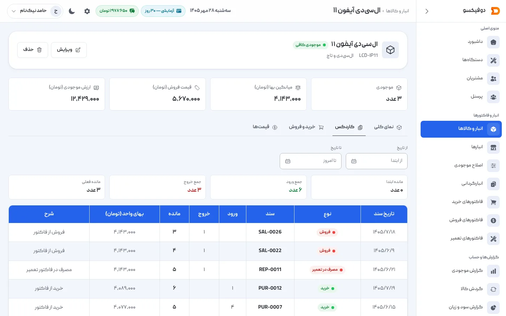
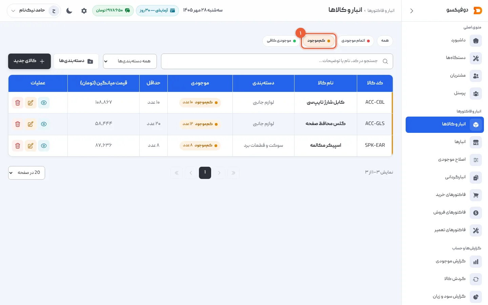

{/* نویسنده: انبار قطعات در مجموعه‌ی شما چطور اداره می‌شود؟ یک دفتر، یک اکسل، یا حافظه؟ یک بار کسری قطعه وسط تعمیر برایتان پیش آمده؟ چه کردید؟ */}

ساعت پنج عصر است. مشتری منتظر گوشی‌اش نشسته، تعمیرکار ال‌سی‌دی A54 را باز کرده و
می‌رود سراغ قفسه — و قطعه نیست. یا هست، ولی کسی که قبلاً خریده قیمتش را یادش
نمانده و حالا نمی‌داند این تعمیر چقدر سود داشت. هر دو حالت یک ریشه دارند: انبار
قطعات تعمیرگاه، بدون سیستم.

## چرا انبارداری تعمیرگاه از یک فروشگاه معمولی سخت‌تر است

فروشگاه کالا را می‌خرد و همان کالا را می‌فروشد. تعمیرگاه قطعه را **مصرف**
می‌کند تا خدمت بفروشد — و این چند فرق مهم دارد:

- یک قطعه معمولاً برای چند مدل گوشی کاربرد دارد؛ بعضی قطعات هم فقط برای یک
  مدل خاص‌اند.
- مصرف نامنظم است. نمی‌دانید فردا چند نفر با چه خرابی‌ای می‌آیند.
- بعضی قطعات با آمدن مدل جدید یک گوشی، یک‌شبه کم‌مصرف می‌شوند.
- قیمت خرید قطعه در ایران هر هفته عوض می‌شود؛ همان قطعه را هفته‌ی بعد گران‌تر
  می‌خرید.

نتیجه، دو خطر در دو جهت مخالف است: کسری قطعه وسط تعمیر، و سرمایه‌ای که در
قطعات راکد خوابیده.

## خطر اول: کسری قطعه وسط تعمیر

وقتی تعمیرکار فکر می‌کند قطعه هست و نیست، یکی از این دو اتفاق می‌افتد: تعمیر
متوقف می‌شود و مشتری معطل می‌ماند، یا با عجله و به قیمت بالاتر از یک
تأمین‌کننده‌ی دیگر خریداری می‌شود. اولی هزینه‌ی رضایت مشتری دارد، دومی هزینه‌ی
نقد.

<Callout type="benefit">

به همین دلیل هر قطعه در دوفیکسو یک **حداقل موجودی** دارد. وقتی تعداد به آن عدد
می‌رسد یا پایین‌تر می‌رود، قطعه در فهرست و داشبورد به‌عنوان «کم‌موجود» دیده
می‌شود — پیش از آنکه وسط یک تعمیر به آن برسید، نه بعدش.

</Callout>

راه ساده‌تر برای شروع، حتی بدون نرم‌افزار: برای ده قطعه‌ای که بیشترین مصرف را
دارند (ال‌سی‌دی، باتری، سوکت شارژ مدل‌های پرتعداد مغازه) یک عدد حداقل بنویسید
و هفته‌ای یک‌بار قفسه را با آن عدد مقایسه کنید.

## خطر دوم: سرمایه‌ای که در قطعات راکد خوابیده

خطر دوم کمتر دیده می‌شود چون دردی که ایجاد می‌کند فوری نیست. قطعه‌ای که برای
یک مدل قدیمی خریده‌اید و دیگر کسی نمی‌آورد، همان‌قدر پول شماست که در صندوق
مانده — فقط شکلش عوض شده. کنترل این خطر با یک سؤال ساده شروع می‌شود: «این
قطعه در سه ماه گذشته چند بار مصرف شده؟»

کاردکس هر قطعه — یعنی تاریخچه‌ی کامل ورود و خروجش — جواب همین سؤال است. اگر
کاردکس یک قطعه ماه‌هاست فقط ورود دارد و خروج ندارد، آن قطعه راکد است.

## بهای تمام‌شده را درست حساب کنید، نه حدس

وقتی قیمت یک قطعه هفته‌به‌هفته عوض می‌شود، سود واقعی هر تعمیر هم به همین
بستگی دارد که بهای آن قطعه را چطور حساب می‌کنید. دو روش رایج و اشتباه:

- **آخرین قیمت خرید:** اگر قطعه‌ای که سه ماه پیش ارزان خریده‌اید را به قیمت
  امروز حساب کنید، سود آن تعمیر را کمتر از واقع نشان می‌دهد.
- **اولین قیمت خرید:** برعکس، سود را بیشتر از واقع نشان می‌دهد.

روش درست **میانگین موزون** قیمت خریدهای موجودی فعلی است: هر خرید تازه این
میانگین را جابه‌جا می‌کند، اما فروش آن را عوض نمی‌کند — و سود هر فروش با بهای
همان لحظه ثبت و بعداً با خریدهای جدید عوض نمی‌شود.

## یک چک‌لیست ساده برای شروع

| قدم | چرا |
|---|---|
| هر قطعه یک کد یکتا بگیرد | پیدا کردن و شمردن سریع‌تر می‌شود |
| برای ده قطعه‌ی پرمصرف، حداقل موجودی تعیین کنید | کسری را قبل از تعمیر می‌بینید |
| موجودی و بهای فعلی هر قطعه را یک‌بار کامل ثبت کنید | نقطه‌ی شروع درست برای حساب‌وکتاب بعدی |
| هر خرید و هر مصرف را همان روز ثبت کنید | کاردکس و میانگین بها درست می‌ماند |
| ماهی یک‌بار قطعات بدون خروج را مرور کنید | سرمایه‌ی راکد را زودتر می‌بینید |

در دوفیکسو، همین پنج قدم با هم کار می‌کنند: کد و حداقل موجودی روی خود کالا
تعریف می‌شود، هر فاکتور خرید و فروش و تعمیر موجودی را خودکار جابه‌جا می‌کند،
و میانگین موزون و کاردکس هر کالا بدون کار دستی به‌روز می‌ماند. جزئیات ثبت و
ویرایش کالا در
[آموزش تعریف کالا و انبار در دوفیکسو](/academy/tutorials/inventory/) است.

## سؤال‌های رایج

**چند قطعه زیاد است برای شروع با یک سیستم؟**
تعداد مهم نیست؛ تنوع مهم است. اگر بیش از بیست کد قطعه دارید یا قیمت‌ها
هفتگی عوض می‌شوند، نگه‌داشتنش روی کاغذ یا حافظه دیگر جواب نمی‌دهد.

**اگر الان همه‌چیز در ذهن یا دفتر است، باید از صفر شمارش کنم؟**
بله، یک‌بار — موجودی اولیه. بعد از آن هر ورود و خروج با خود فاکتور ثبت
می‌شود و دیگر شمارش دستی لازم نیست، مگر برای کنترل دوره‌ای.

**موجودی منفی می‌شود اگر اشتباهی بیشتر از انبار بفروشم؟**
نه؛ فروش یا مصرف بیشتر از موجودی باید رد شود، نه ثبت با عدد منفی — وگرنه
گزارش‌ها از همان‌جا غلط می‌شوند.

**اگر بیش از یک انبار دارم چه؟**
وقتی بیشتر از یک انبار فعال دارید، موجودی باید به تفکیک هر انبار دیده شود و
انتقال بین انبارها هم مسیر مشخصی داشته باشد، نه جابه‌جایی دستی بدون سند.

## جمع‌بندی

انبار قطعات تعمیرگاه دو خطر دارد، نه یکی: کسری وسط تعمیر، و سرمایه‌ای که در
قطعات راکد می‌خوابد. یک کد و یک حداقل برای هر قطعه جلوی خطر اول را می‌گیرد؛
نگاه دوره‌ای به کاردکس جلوی خطر دوم را. برای دیدن کل تصویر مدیریت تعمیرگاه —
از پذیرش دستگاه تا همین انبار و فاکتور — راهنمای
[مدیریت تعمیرگاه موبایل](/academy/guide/mobile-repair-shop-management/) را
بخوانید، و برای انتخاب نرم‌افزار مناسب،
[بهترین نرم‌افزار مدیریت تعمیرگاه موبایل](/academy/guide/mobile-repair-software/)
را.

<NextStep
  title="می‌خواهید همین حالا انبار واقعی‌تان را ثبت کنید؟"
  to="tutorials/inventory"
  label="آموزش تعریف کالا و انبار در دوفیکسو"
>

قدم‌به‌قدم کد، دسته، قیمت فروش، حداقل موجودی و موجودی اولیه‌ی هر قطعه را در
دوفیکسو ثبت می‌کنید، و صفحه‌ی هر کالا — کاردکس، میانگین بها و قیمت‌های خرید —
را می‌خوانید.

</NextStep>
