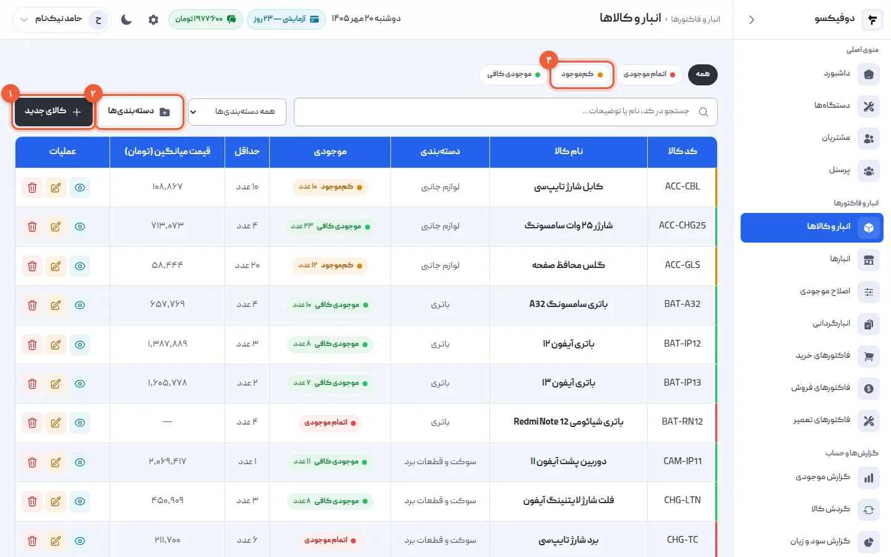
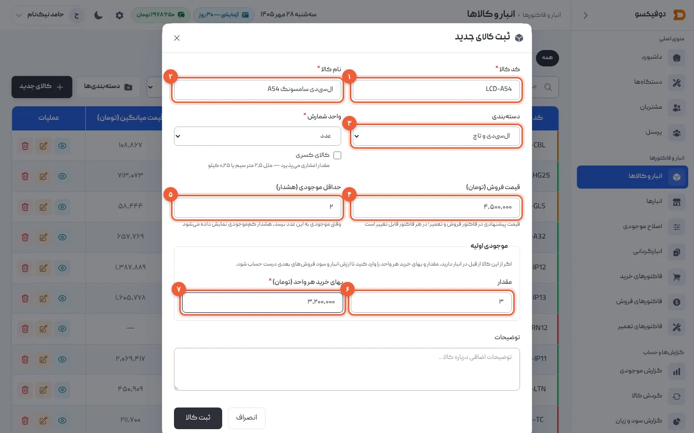
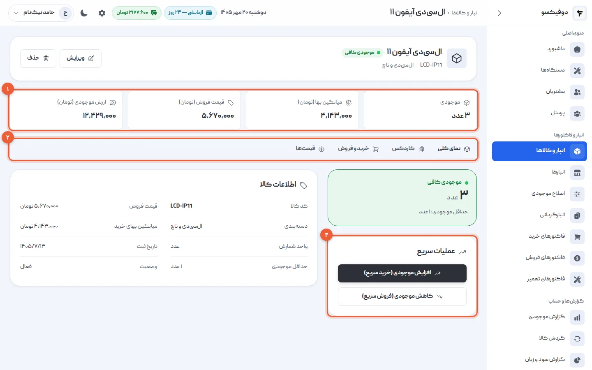
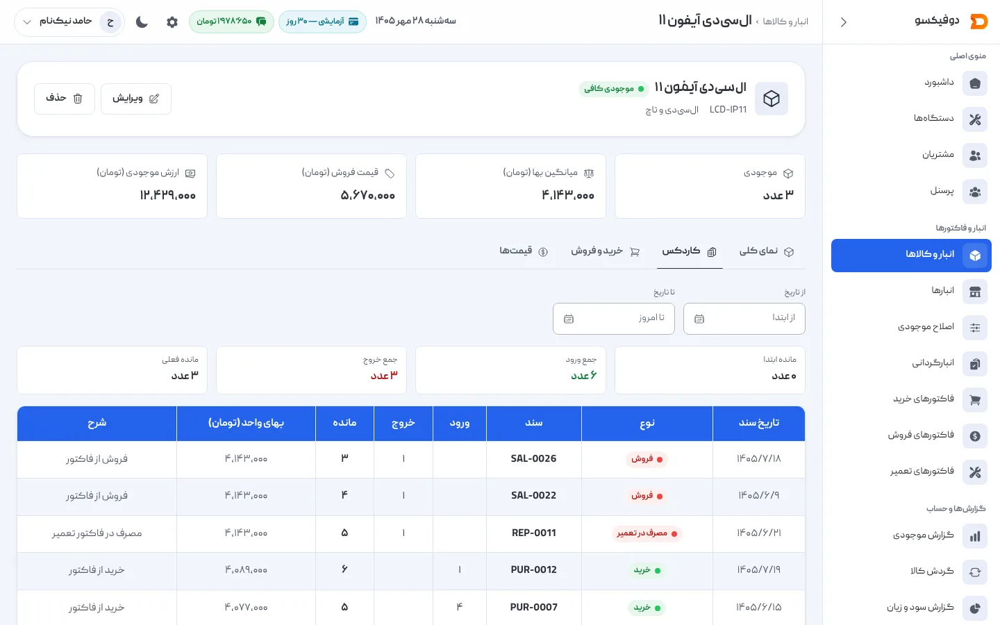
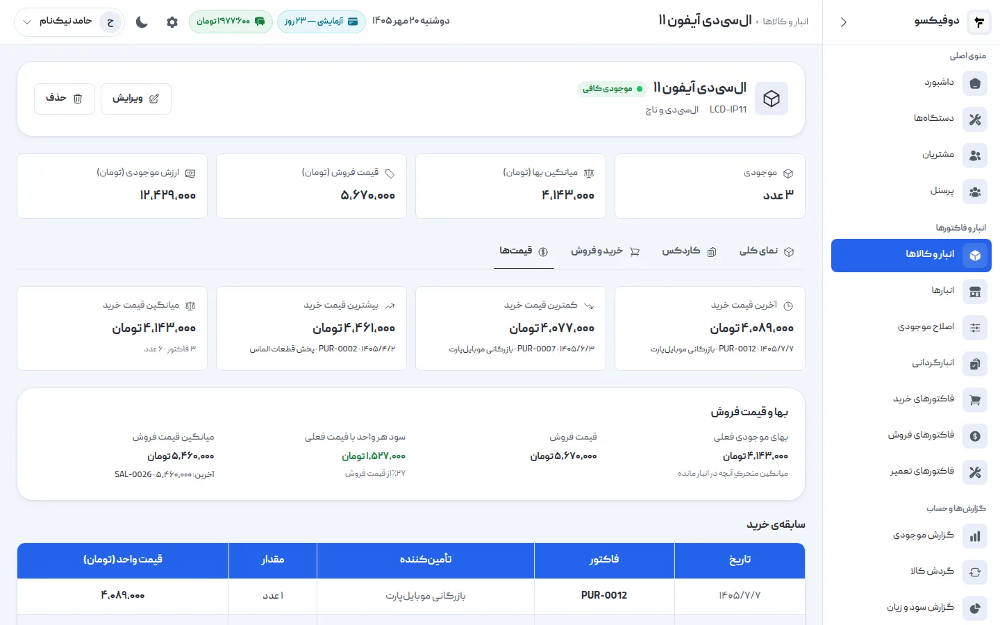
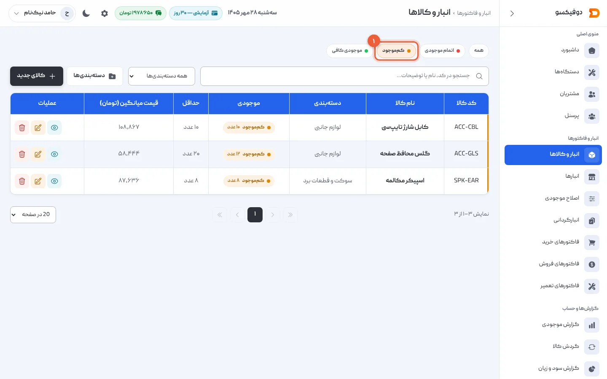
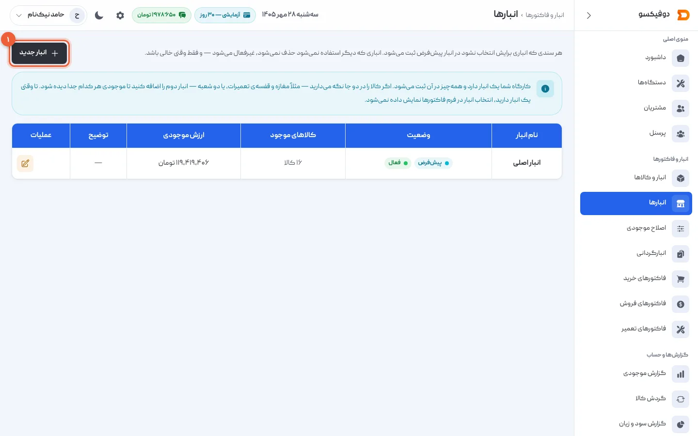

«ال‌سی‌دی داریم؟» سؤالی است که در هر تعمیرگاه روزی چند بار پرسیده می‌شود — و اگر
جوابش با شمردن قفسه پیدا شود، یعنی یا کسی وقت گذاشته، یا جواب غلط است. در دوفیکسو
موجودی هر قطعه با هر فاکتور خودش جابه‌جا می‌شود: خرید اضافه‌اش می‌کند، فروش و
قطعه‌ای که روی فاکتور تعمیر رفته کمش می‌کنند. موجودی هیچ‌وقت منفی نمی‌شود.

در این آموزش قطعه تعریف می‌کنیم، موجودی‌ای را که از قبل دارید وارد می‌کنیم و صفحه‌ی
هر کالا را می‌خوانیم: کاردکس، میانگین بها و قیمت‌های خرید.

## ۱. صفحه‌ی انبار و کالاها

از منوی کناری **«انبار و کالاها»** را باز کنید. هر قطعه با کد، دسته، موجودی،
حداقل موجودی و **میانگین بها** این‌جاست.

- **«کالای جدید»** (۱): قدم بعد.
- **«دسته‌بندی‌ها»** (۲): دسته‌هایتان را بسازید — مثلاً «ال‌سی‌دی و تاچ»، «باتری»،
  «لوازم جانبی» — تا قطعه‌ها مرتب باشند و فهرست را بشود بر اساس دسته فیلتر کرد.
- **«کم‌موجود»** (۳) و «اتمام موجودی»: قطعه‌هایی که باید سفارش داد. (قدم ۶)

## ۲. قطعه‌ی تازه تعریف کنید

«کالای جدید» را بزنید:

- **کد کالا** (۱): کدی کوتاه و یکتا، مثلاً `LCD-A54`. با همین کد هم جستجو می‌شود.
- **نام کالا** (۲)
- **دسته‌بندی** (۳)
- **واحد شمارش**: برای قطعه «عدد». برای سیم یا مایعی که متری یا لیتری می‌فروشید،
  واحد را «متر» یا «لیتر» بگذارید؛ «کالای کسری» خودش تیک می‌خورد و مقدار اعشاری
  (مثلاً ۲٫۵ متر) پذیرفته می‌شود.
- **قیمت فروش** (۴): قیمت پیشنهادی در فاکتور فروش و تعمیر؛ در هر فاکتور قابل
  تغییر است.
- **حداقل موجودی** (۵): وقتی موجودی به این عدد برسد، کالا «کم‌موجود» می‌شود.
- **موجودی اولیه**: اگر این قطعه را از قبل در قفسه دارید، **مقدار** (۶) و **بهای خرید
  هر واحد** (۷).

«ثبت کالا» را بزنید.

<Callout type="benefit">
بهای موجودی اولیه را حدس هم که شده بنویسید. از همین عدد، **ارزش انبار** و **سود
اولین فروش‌های** این قطعه حساب می‌شود. اگر بعداً فهمیدید اشتباه بوده، از ویرایش
کالا اصلاحش کنید؛ خرید و فروش‌های بعدی سر جایشان می‌مانند و اصلاح در کاردکس ثبت
می‌شود.
</Callout>

قطعه‌هایی که از این به بعد می‌خرید را با **فاکتور خرید** وارد کنید، نه موجودی
اولیه — [آموزش فاکتور خرید](/academy/tutorials/purchase-invoice/).

## ۳. صفحه‌ی هر کالا

روی هر کالا در فهرست بزنید. بالای صفحه‌اش چهار عدد است (۱): **موجودی**، **میانگین
بها**، **قیمت فروش** و **ارزش موجودی** — یعنی این قطعه‌ها روی قفسه‌ی شما چقدر
می‌ارزند.

زیرش چهار تب (۲): **نمای کلی**، **کاردکس**، **خرید و فروش** و **قیمت‌ها**. در نمای
کلی، **«عملیات سریع»** (۳) هم هست: «افزایش موجودی (خرید سریع)» و «کاهش موجودی
(فروش سریع)» — برای وقتی که یک قطعه را بی‌فاکتور مفصل خریده یا فروخته‌اید. این‌ها
هم یک فاکتور خرید یا فروش واقعی می‌سازند، پس در حساب‌ها گم نمی‌شوند.

## ۴. کاردکس: هر عدد از کجا آمده

تب **«کاردکس»** همه‌ی حرکت‌های این قطعه است، جدیدترین بالا: تاریخ، نوع حرکت (خرید،
فروش، مصرف در تعمیر، …)، **شماره‌ی سند**، ورود، خروج، **مانده** و بهای هر واحد.

روی هر شماره‌ی سند بزنید تا همان فاکتور باز شود. با فیلتر تاریخ، چهار کارت بالا
مانده‌ی اول و آخر بازه و جمع ورود و خروج را نشان می‌دهند.

<Callout type="benefit">
وقتی موجودی با قفسه نمی‌خواند، کاردکس جواب را دارد: کدام فاکتور، کدام روز، چند
عدد. ال‌سی‌دی‌ای که روی فاکتور تعمیر **REP-0011** رفته، همان‌جا با شماره‌اش دیده
می‌شود — به‌جای بحث سر اینکه «کی برش داشته؟».
</Callout>

## ۵. قیمت‌ها و سود هر واحد

تب **«قیمت‌ها»** می‌گوید این قطعه را تا حالا چند خریده‌اید: **آخرین**، **کمترین** و
**بیشترین** قیمت خرید — هر کدام با فاکتور و فروشنده‌اش — و **میانگین قیمت خرید**.
پایین‌تر، **بهای موجودی فعلی** کنار **قیمت فروش** و **سود هر واحد**.

**بهای موجودی** میانگین موزون خریدهای قطعه‌هایی است که الان در قفسه دارید: هر خرید
تازه آن را به سمت قیمت جدید می‌برد، و فروش تغییرش نمی‌دهد. سود هر فروش هم با بهای
**همان لحظه‌ی فروش** ثبت می‌شود؛ اگر فردا قطعه را گران‌تر خریدید، سود فروش دیروز
عوض نمی‌شود.

<Callout type="benefit">
قیمت قطعه هر هفته عوض می‌شود. وقتی بهای موجودی و سود هر واحد کنار هم‌اند، می‌بینید
قیمت فروشتان هنوز سود می‌دهد یا وقتش رسیده بالا ببریدش — پیش از اینکه آخر ماه
بفهمید.
</Callout>

## ۶. قطعه‌های رو به اتمام

در فهرست کالاها، فیلتر **«کم‌موجود»** (۱) قطعه‌هایی را نشان می‌دهد که موجودی‌شان به
حداقل یا زیر آن رسیده، و «اتمام موجودی» آن‌هایی که صفر شده‌اند.

همین شمارش در **داشبورد** («کالاهای کم‌موجود») و در **گزارش موجودی** هم هست. دوفیکسو
برای کم‌موجود شدن پیامک یا اعلان نمی‌فرستد؛ این فهرست را پیش از سفارش قطعه نگاه
کنید.

## ۷. انبارها

دوفیکسو با یک انبار شروع می‌شود: **«انبار اصلی»**. تا وقتی فقط یکی دارید، هیچ‌جا
انتخاب انبار نمی‌بینید و لازم نیست به آن فکر کنید.

اگر قطعه‌ها را در دو جا نگه می‌دارید — مثلاً پیشخوان مغازه و قفسه‌ی تعمیرات — از **«انبار جدید»** (۱) دومی را بسازید. آن‌وقت فاکتورها انتخاب انبار پیدا
می‌کنند، صفحه‌ی هر کالا موجودی هر انبار را جدا نشان می‌دهد، و منوی **«انتقال بین
انبارها»** برای جابه‌جایی قطعه اضافه می‌شود.

## وقتی موجودی با قفسه نمی‌خواند

دو ابزار دیگر از همین منو:

- **«اصلاح موجودی»**: برای قطعه‌ای که شکسته، گم شده یا در خود مغازه مصرف شده — یا
  پیدا شده. هر اصلاح با دلیلش یک سند با شماره‌ی `ADJ-…` است.
- **«انبارگردانی»**: شمارش واقعی قفسه، حتی از روی گوشی، و اعمال اختلاف‌ها یک‌جا.

## اگر … شد چه کنم؟

**«کد کالا تکراری است»:** کالایی با همین کد دارید. یا کد دیگری بگذارید، یا همان
کالای قبلی را ویرایش کنید.

**«برای موجودی اولیه، بهای خرید هر واحد الزامی است»:** وقتی مقدار موجودی اولیه
می‌نویسید، بهایش هم لازم است تا ارزش انبار و سود درست حساب شود.

**مقدار اعشاری پذیرفته نمی‌شود:** واحد کالا «عدد» است. برای کالایی که کسری فروخته
می‌شود، «کالای کسری» را تیک بزنید.

**فروش یا فاکتور تعمیر با پیام کمبود موجودی رد شد:** دوفیکسو موجودی را منفی
نمی‌کند. اول فاکتور خرید آن قطعه را ثبت کنید، یا اگر قطعه واقعاً در قفسه هست، با
«اصلاح موجودی» موجودی را درست کنید.

**کالا حذف نمی‌شود:** کالایی که فاکتور یا سندی به نامش هست حذف نمی‌شود، چون
سابقه‌اش از دست می‌رود.

<NextStep
  title="قطعه‌ها را با فاکتور خرید وارد انبار کنید"
  to="tutorials/purchase-invoice"
  label="آموزش فاکتور خرید"
>

هر خرید از فروشنده با یک فاکتور خرید ثبت می‌شود: موجودی بالا می‌رود، میانگین بها
به‌روز می‌شود، و بدهی شما به فروشنده تا تسویه پیدا می‌ماند.

</NextStep>
