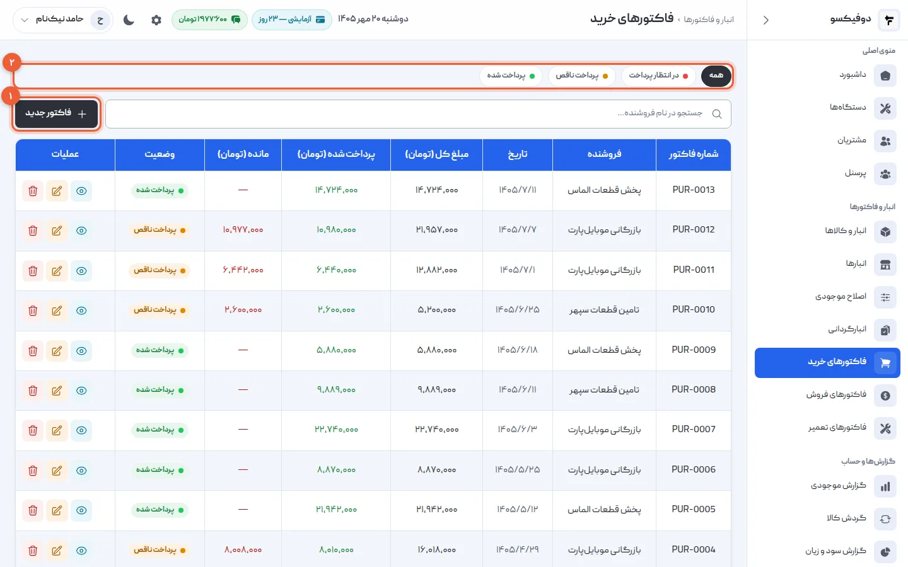
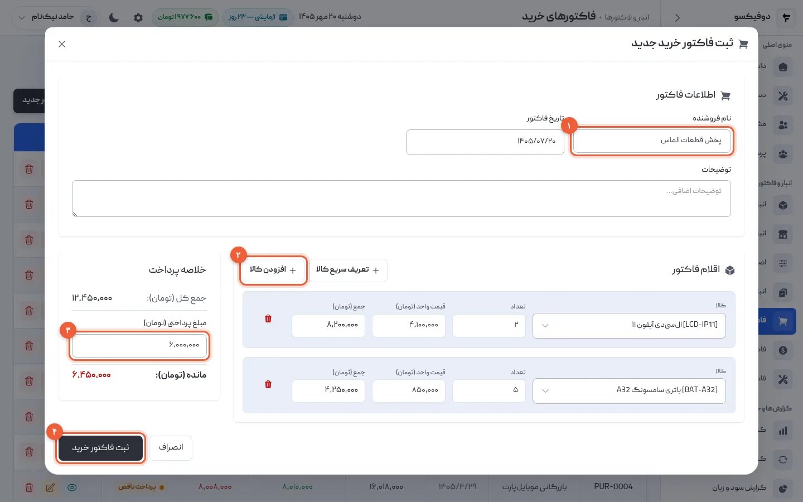
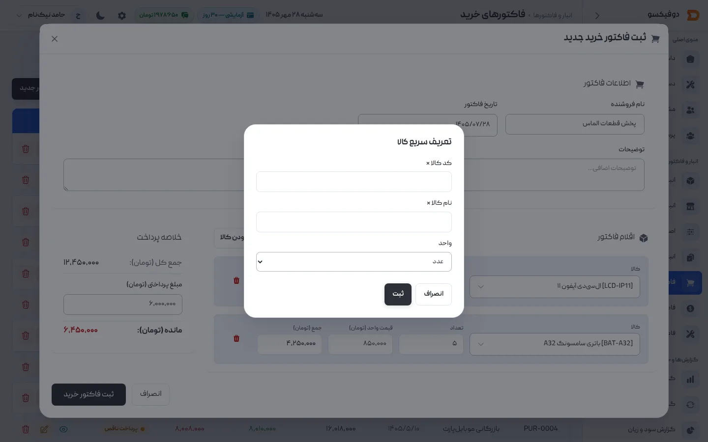
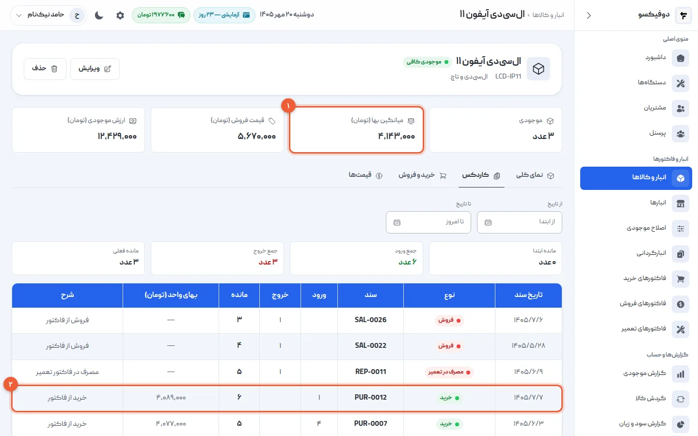
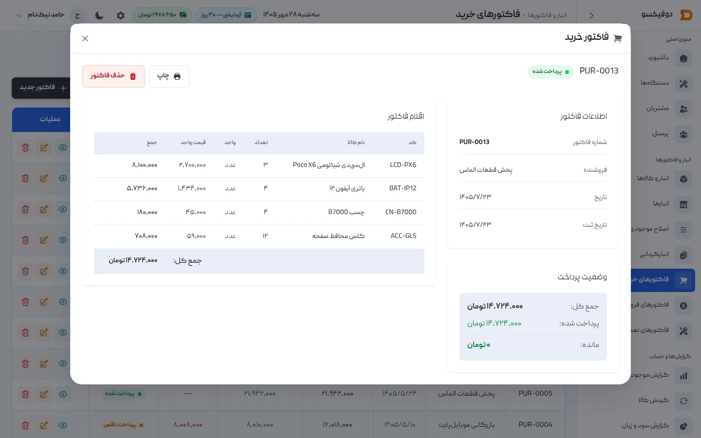

هر قطعه‌ای که از بازار می‌خرید، باید یک جا وارد انبار شود — وگرنه موجودی دروغ
می‌گوید و سود فروش‌ها از روی حدس حساب می‌شود. در دوفیکسو این «یک جا» فاکتور خرید
است: فروشنده، قطعه‌ها، تعداد و قیمت هر کدام، و اینکه چقدر پرداخت کرده‌اید. با ثبتش،
موجودی بالا می‌رود و قیمت تمام‌شده‌ی هر قطعه خودش به‌روز می‌شود.

این آموزش فرض می‌کند قطعه‌هایتان را تعریف کرده‌اید — اگر نه، [آموزش تعریف کالا و
انبار](/academy/tutorials/inventory/) را ببینید. (قطعه‌ی تازه را وسط همین فاکتور
هم می‌شود تعریف کرد؛ قدم ۳.)

## ۱. فهرست فاکتورهای خرید

از منوی کناری **«فاکتورهای خرید»** را باز کنید. هر خرید با شماره‌ی `PUR-…`،
فروشنده، تاریخ، مبلغ، پرداخت‌شده و **مانده** این‌جاست.

- **«فاکتور جدید»** (۱): قدم بعد.
- **فیلتر وضعیت پرداخت** (۲): «در انتظار پرداخت» و «پرداخت ناقص» یعنی خریدهایی
  که هنوز به فروشنده بدهکارید.

## ۲. فاکتور خرید تازه ثبت کنید

«فاکتور جدید» را بزنید:

1. **نام فروشنده** (۱) و تاریخ فاکتور را بنویسید. تاریخ از قبل امروز است.
2. **«افزودن کالا»** (۲) را بزنید، قطعه را از فهرست پیدا کنید، و **تعداد** و **قیمت
   واحد** را بنویسید. برای هر قطعه‌ی دیگر، دوباره «افزودن کالا».
3. در **مبلغ پرداختی** (۳) بنویسید همین حالا چقدر پرداخت کرده‌اید. اگر نقد و کامل
   پرداخت کردید، همان جمع کل؛ اگر نسیه خریدید، صفر یا هر چقدر که دادید. **مانده**
   همان زیر حساب می‌شود.
4. **«ثبت فاکتور خرید»** (۴) را بزنید.

اگر بیش از یک انبار دارید، کنار تاریخ یک **«ورود به انبار»** هم می‌بینید که می‌گوید
قطعه‌های این فاکتور به کدام انبار رفتند.

<Callout type="benefit">
با «ثبت فاکتور خرید»، **موجودی همان لحظه بالا می‌رود** و قطعه در فاکتورهای فروش و
تعمیر قابل استفاده است. لازم نیست جای دیگری موجودی را دستی عوض کنید.
</Callout>

## ۳. قطعه‌ی تازه را همان‌جا تعریف کنید

قطعه‌ای خریده‌اید که هنوز در دوفیکسو نیست؟ فرم را نبندید: **«تعریف سریع کالا»**
را بزنید، **کد**، **نام** و **واحد** را بنویسید و «ثبت» را بزنید. کالا ساخته می‌شود
و همان لحظه در فهرست «افزودن کالا» پیدایش می‌کنید.

بعداً از «انبار و کالاها» دسته، قیمت فروش و حداقل موجودی‌اش را کامل کنید.

## ۴. خرید چه چیزی را عوض می‌کند

فرض کنید ۳ ال‌سی‌دی در قفسه دارید با بهای هر عدد ۴٬۱۰۰٬۰۰۰ تومان، و ۲ تای دیگر به
۴٬۶۰۰٬۰۰۰ می‌خرید. حالا ۵ عدد دارید و **میانگین بها** می‌شود:

> (۳ × ۴٬۱۰۰٬۰۰۰ + ۲ × ۴٬۶۰۰٬۰۰۰) ÷ ۵ = **۴٬۳۰۰٬۰۰۰ تومان**

این میانگین موزون، **قیمت تمام‌شده‌ی** هر ال‌سی‌دی است که از این به بعد می‌فروشید یا
روی تعمیر مصرف می‌کنید. فروش آن را تغییر نمی‌دهد؛ فقط خرید بعدی جابه‌جایش می‌کند.

در صفحه‌ی هر کالا، **میانگین بها** (۱) همین عدد است، و در **کاردکس** هر خرید با
شماره‌ی فاکتورش (۲) و بهایی که آمده دیده می‌شود.

<Callout type="benefit">
قیمت قطعه در بازار هر هفته عوض می‌شود. با میانگین موزون، سودی که دوفیکسو برای هر
فروش و هر تعمیر حساب می‌کند به قیمتی است که **واقعاً** برای قطعه‌های همان قفسه
پرداخته‌اید — نه به آخرین قیمت بازار، و نه به قیمتی که سه ماه پیش یادتان مانده.
</Callout>

## ۵. پرداخت ناقص و بدهی به فروشنده

روی **«مشاهده جزئیات»** هر فاکتور بزنید: اقلام، و در کادر **«وضعیت پرداخت»** جمع کل،
پرداخت‌شده و مانده.

وقتی بقیه‌ی پول فروشنده را دادید، مبلغ پرداخت‌شده را از همین‌جا به‌روز کنید؛ وضعیت
خودش «پرداخت شده» می‌شود.

دکمه‌ی **«چاپ»** همین‌جا، فاکتور خرید را با همان قالبی چاپ می‌کند که در
[تنظیمات فاکتورها](/academy/tutorials/settings/) برای فاکتور فروش و تعمیر گذاشته‌اید —
برای بایگانی کنار برگه‌ی فروشنده، یا PDF برای حسابدارتان.

<Callout type="tip">
فیلتر «پرداخت ناقص» و «در انتظار پرداخت» در فهرست فاکتورهای خرید، فهرست
بدهی‌هایتان به فروشنده‌هاست. پیش از رفتن به بازار یک نگاه بیندازید.
</Callout>

## ۶. ویرایش و حذف

فاکتور خرید **قابل ویرایش** است — از دکمه‌ی «ویرایش فاکتور» در ردیفش — و موجودی و
میانگین بها هم‌پایش اصلاح می‌شوند. شماره‌ی فاکتور عوض نمی‌شود.

یک استثنا: اگر قطعه‌های این خرید **فروخته یا روی تعمیر مصرف شده‌اند**، نمی‌شود خرید را
حذف کرد یا مقدارش را کمتر از آنچه رفته کرد. دوفیکسو با پیام توضیح رد می‌کند، چون
موجودی منفی می‌شد. اگر واقعاً اشتباهی ثبت شده، با «اصلاح موجودی» درستش کنید.

## اگر … شد چه کنم؟

**«حداقل یک کالا باید انتخاب شود»:** فاکتور خرید بدون قطعه ثبت نمی‌شود. با «افزودن
کالا» دست‌کم یک ردیف اضافه کنید.

**«این کالا فقط عدد صحیح می‌پذیرد»:** واحد این قطعه «عدد» است. تعداد را بدون اعشار
بنویسید.

**«مبلغ پرداختی نمی‌تواند بیشتر از جمع کل باشد»:** مبلغ پرداختی را با جمع کل مقایسه
کنید؛ بیشتر از فاکتور پرداخت نمی‌شود.

**قطعه در فهرست «افزودن کالا» نیست:** هنوز تعریف نشده. از «تعریف سریع کالا» (قدم ۳)
همان‌جا بسازیدش.

**حذف یا ویرایش فاکتور رد شد:** بخشی از قطعه‌های این خرید فروخته یا مصرف شده است
(قدم ۶).

<NextStep
  title="قطعه‌ها را روی فاکتور تعمیر مصرف کنید"
  to="tutorials/repair-invoice"
  label="آموزش فاکتور تعمیر"
>

قطعه‌ای که خریدید، روی فاکتور تعمیر همان گوشی می‌رود — و با صدور فاکتور، همان‌جا از
انبار کم می‌شود.

</NextStep>
