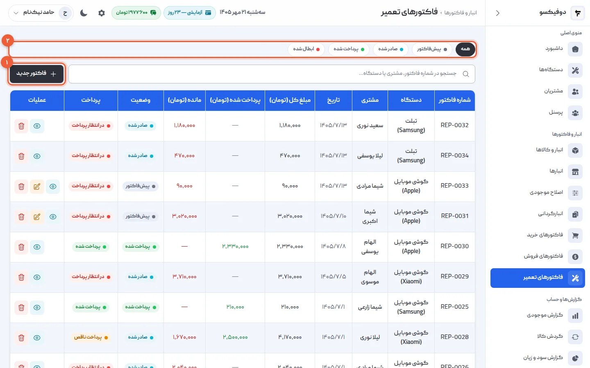
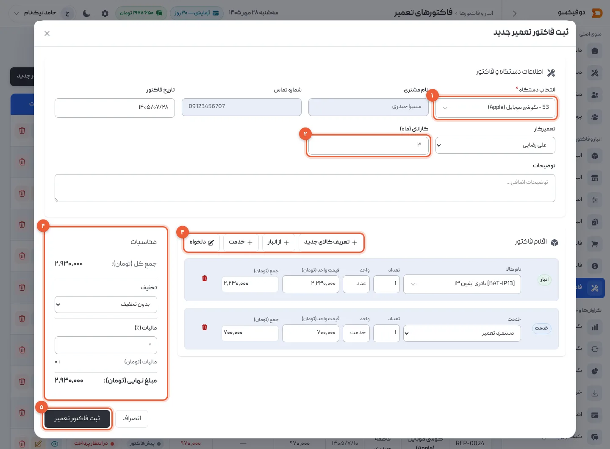
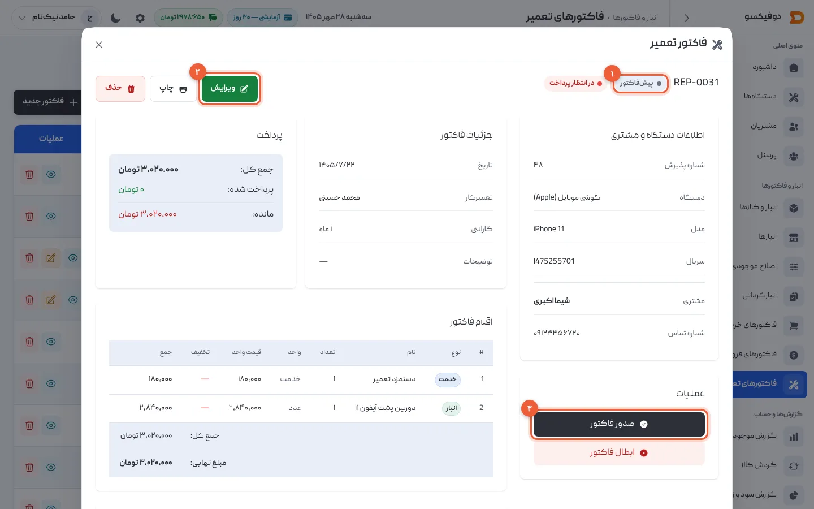
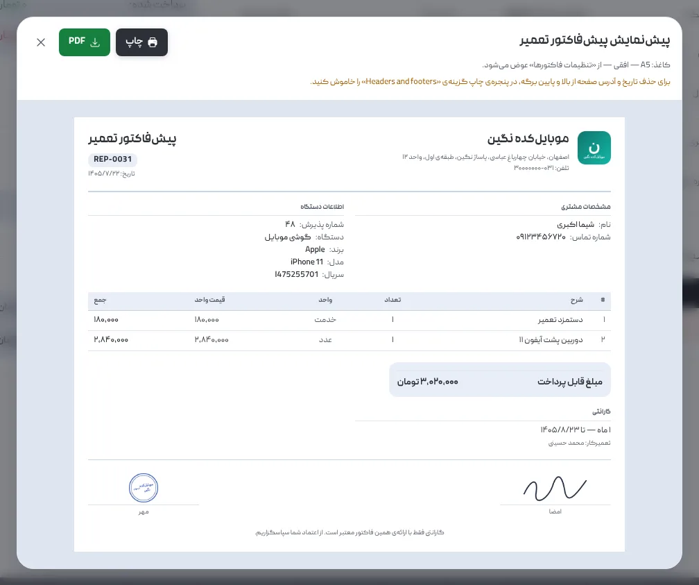
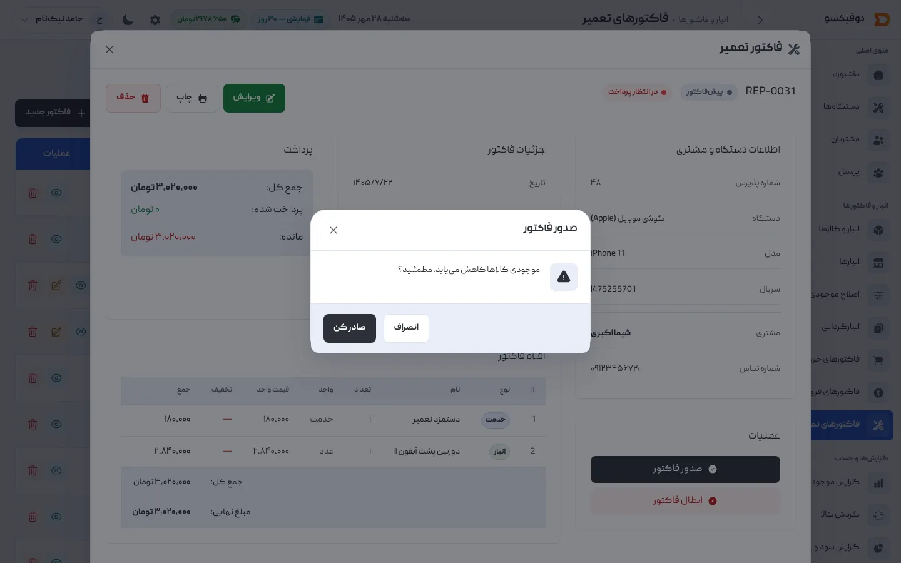
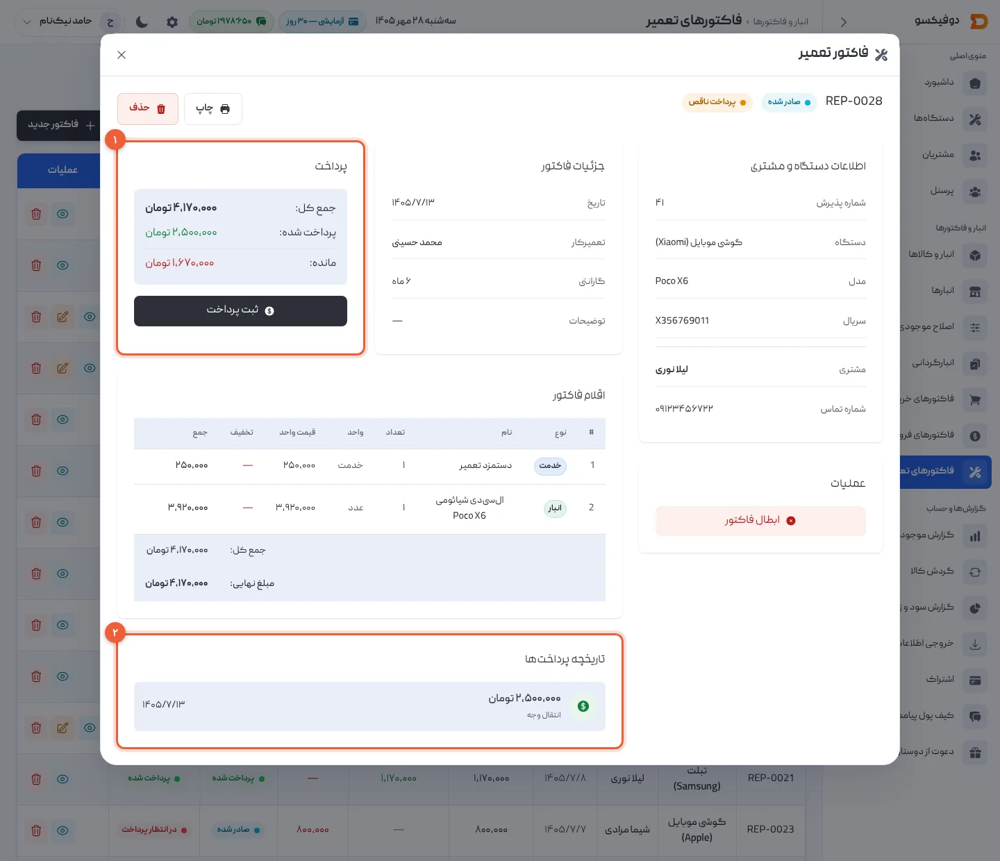
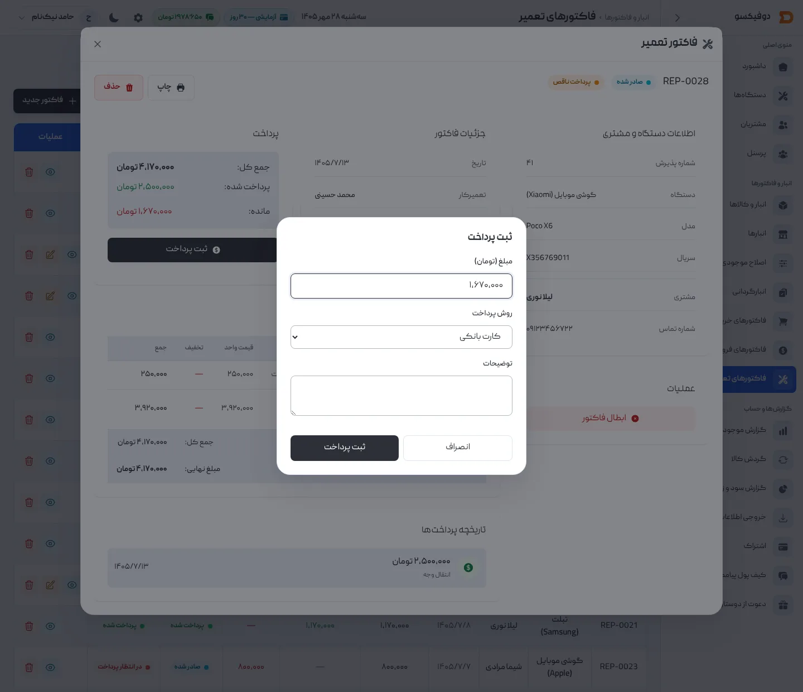

گوشی تعمیر شد؛ حالا باید معلوم شود مشتری بابت چه چیزی چقدر می‌دهد. در دوفیکسو
این کار فاکتور تعمیر است: قطعه‌ای که از قفسه برداشتید، اجرتتان، تخفیف و گارانتی —
همه روی همان گوشی و همان مشتری. فاکتور تعمیر دو مرحله دارد. اول **پیش‌فاکتور**
است که هنوز هیچ چیزی را جابه‌جا نمی‌کند، و بعد **فاکتور صادرشده** که قطعه‌ها را از
انبار کم می‌کند و پرداخت می‌گیرد.

این آموزش فرض می‌کند گوشی را [پذیرش کرده‌اید](/academy/tutorials/device-intake/) و
قطعه‌هایتان [در انبار تعریف شده‌اند](/academy/tutorials/inventory/). فاکتور تعمیر را
فقط مدیرها می‌بینند؛ تکنسین به این صفحه دسترسی ندارد.

## ۱. فهرست فاکتورهای تعمیر

از منوی کناری **«فاکتورهای تعمیر»** را باز کنید. هر فاکتور با شماره‌ی `REP-…`،
دستگاه، مشتری، مبلغ کل، پرداخت‌شده و **مانده** این‌جاست.

- **«فاکتور جدید»** (۱): قدم بعد.
- **فیلتر وضعیت** (۲): چهار وضعیت، به همان ترتیبی که یک فاکتور طی می‌کند —
  **پیش‌فاکتور**، **صادر شده**، **پرداخت شده** و **ابطال شده**. روی هر کدام بزنید
  تا فقط همان‌ها بمانند.

## ۲. فاکتور تعمیر تازه بسازید

«فاکتور جدید» را بزنید:

1. **انتخاب دستگاه** (۱): شماره‌ی پذیرش، نام مشتری یا مدل گوشی را بنویسید و گوشی
   را انتخاب کنید. نام و شماره‌ی مشتری خودشان پر می‌شوند. **تعمیرکار** را هم
   انتخاب کنید؛ تاریخ از قبل امروز است.
2. **گارانتی (ماه)** (۲): از [تنظیمات](/academy/tutorials/settings/) پر شده؛ اگر برای
   این تعمیر فرق دارد، عوضش کنید. اگر گارانتی نمی‌دهید، ۰ بگذارید.
3. **اقلام فاکتور** (۳): برای هر ردیف یکی از این دکمه‌ها:
   - **«از انبار»**: قطعه‌ای که از قفسه برداشته‌اید. در فهرست، موجودی و قیمت فروش هر
     قطعه کنارش است و قیمت خودش پر می‌شود.
   - **«خدمت»**: اجرت — «دستمزد تعمیر»، «هزینه تست و عیب‌یابی» و … — با مبلغی که
     می‌نویسید.
   - **«دلخواه»**: هر چیزی که نه در انبار است نه در خدمات؛ مثلاً قطعه‌ای که فقط برای
     همین گوشی از بیرون گرفتید. ردیف دلخواه به انبار دست نمی‌زند.
4. **محاسبات** (۴): **تخفیف** درصدی یا مبلغ ثابت، و **مالیات** که از تنظیمات آمده.
   مبلغ نهایی همان‌جا حساب می‌شود.
5. **«ثبت فاکتور تعمیر»** (۵) را بزنید.

فاکتور به‌صورت **پیش‌فاکتور** ذخیره می‌شود و هنوز هیچ قطعه‌ای از انبار کم نشده است.

اگر بیش از یک انبار دارید، کنار گارانتی یک **«برداشت قطعات از انبار»** هم می‌بینید
که می‌گوید قطعه‌ها از کدام انبار بروند.

<Callout type="tip">
قطعه هنوز در دوفیکسو تعریف نشده؟ **«تعریف کالای جدید»** فرم کالا را باز می‌کند و
فاکتور تعمیر باز می‌ماند. ولی قطعه‌ی «از انبار» باید موجودی داشته باشد: اگر تازه
خریدیدش، [فاکتور خریدش](/academy/tutorials/purchase-invoice/) را هم ثبت کنید.
</Callout>

## ۳. پیش‌فاکتور: پیش از شروع کار، با مشتری توافق کنید

روی **«جزئیات»** فاکتور بزنید. وضعیتش **پیش‌فاکتور** است (۱).

- **«ویرایش»** (۲): تا وقتی پیش‌فاکتور است، هر چیزی را عوض کنید — قطعه، اجرت،
  تخفیف، گارانتی. شماره‌ی فاکتور عوض نمی‌شود.
- **«صدور فاکتور»** (۳): وقتی مشتری قبول کرد. قدم بعد.

با **«چاپ»** پیش‌فاکتور را چاپ کنید یا PDF بگیرید و برای مشتری بفرستید. بالای
برگه نوشته **«پیش‌فاکتور تعمیر»**، تا با فاکتور نهایی اشتباه نشود.

<Callout type="benefit">
قبل از باز کردن گوشی، مشتری روی کاغذ می‌بیند چه قطعه‌ای عوض می‌شود و چقدر می‌دهد.
اگر قبول نکرد، پیش‌فاکتور را عوض کنید یا کنار بگذارید. هیچ قطعه‌ای جابه‌جا نشده و
موجودی‌تان دست‌نخورده است.
</Callout>

## ۴. فاکتور را صادر کنید

«صدور فاکتور» را بزنید. دوفیکسو می‌پرسد: **«موجودی کالاها کاهش می‌یابد.
مطمئنید؟»** — «صادر کن» را بزنید.

با صدور:

- قطعه‌های «از انبار» همان لحظه از موجودی کم می‌شوند — **یک بار، و فقط یک بار**.
  اگر یکی از آن‌ها به اندازه‌ی کافی در انبار نباشد، صدور با پیامی که نام قطعه را
  می‌گوید رد می‌شود و هیچ چیز جابه‌جا نمی‌شود.
- بهای تمام‌شده‌ی هر قطعه در همان لحظه روی فاکتور می‌ماند؛ سودی که گزارش سود و زیان
  برای این تعمیر نشان می‌دهد، با همین بهاست.
- فاکتور دیگر **ویرایش نمی‌شود** و به پیش‌فاکتور برنمی‌گردد. اگر اشتباهی در آن
  هست، ابطالش کنید و فاکتور تازه بسازید (قدم ۶).

## ۵. پرداخت: بیعانه، و باقی پول

فاکتور صادرشده پرداخت می‌گیرد. در جزئیات فاکتور، کادر **«پرداخت»** (۱) جمع کل،
پرداخت‌شده و **مانده** را نشان می‌دهد، و **«تاریخچه پرداخت‌ها»** (۲) هر پرداخت را با
مبلغ، روش و تاریخ خودش.

**«ثبت پرداخت»** را بزنید:

- **مبلغ**: آنچه همین حالا گرفتید. بیشتر از مانده پذیرفته نمی‌شود.
- **روش پرداخت**: نقدی، کارت بانکی یا انتقال وجه.
- **توضیحات**: هر چه بعداً لازم دارید؛ مثلاً شماره‌ی پیگیری کارت‌به‌کارت.

پرداخت با **تاریخ همان روز** ثبت می‌شود. وقتی جمع پرداخت‌ها به مبلغ فاکتور رسید،
وضعیت خودش **«پرداخت شده»** می‌شود.

<Callout type="tip">
پرداخت ثبت‌شده را نمی‌شود ویرایش یا حذف کرد. پیش از «ثبت پرداخت» مبلغ را یک بار
دیگر با پولی که گرفتید مقایسه کنید.
</Callout>

<Callout type="benefit">
مشتری موقع پذیرش بیعانه داد و بقیه را موقع تحویل می‌دهد؟ هر دو روی همان فاکتور
ثبت می‌شوند و مانده همیشه جلوی چشم است. فیلتر **«صادر شده»** در فهرست، یعنی
تعمیرهایی که هنوز تمام پولشان را نگرفته‌اید.
</Callout>

## ۶. ابطال و حذف

**ابطال:** فاکتور صادرشده‌ای که اشتباه بوده، از کادر «عملیات» با **«ابطال فاکتور»**
باطل می‌شود. قطعه‌هایش به انبار برمی‌گردند، و فاکتور با همان شماره و وضعیت
**«ابطال شده»** در فهرست می‌ماند. پیش‌فاکتور را هم می‌شود ابطال کرد. فاکتوری که
**کامل پرداخت شده**، ابطال نمی‌شود.

**حذف:** مدیرها فاکتور را با «حذف» کاملاً پاک می‌کنند؛ اگر قطعه‌هایش از انبار رفته
بودند، برمی‌گردند. ولی پرداخت‌هایش هم با آن پاک می‌شوند و شماره‌اش در فهرست خالی
می‌ماند.

<Callout type="warning">
برای فاکتور صادرشده، **ابطال** را به حذف ترجیح دهید. فاکتور ابطال‌شده با همه‌ی
پرداخت‌هایش در پرونده می‌ماند و ماه بعد معلوم است چه شد و چرا. حذف را برای
پیش‌فاکتوری نگه دارید که اشتباهی ساخته شده.
</Callout>

## ۷. چاپ و گارانتی

در جزئیات هر فاکتور، **«چاپ»** پیش‌نمایش فاکتور را با لوگو، اطلاعات تعمیرگاه، مهر
و امضا باز می‌کند. از آن‌جا چاپ کنید یا PDF بگیرید. **تاریخ پایان گارانتی** از
تاریخ فاکتور و تعداد ماه گارانتی حساب می‌شود و روی فاکتور چاپی می‌آید. شکل
فاکتور چاپی در [آموزش تنظیمات](/academy/tutorials/settings/) آمده است.

## اگر … شد چه کنم؟

**«موجودی کافی نیست»:** این قطعه به اندازه‌ای که نوشتید در انبار نیست. اگر خریده‌اید،
[فاکتور خریدش](/academy/tutorials/purchase-invoice/) را ثبت کنید؛ اگر عدد انبار غلط
است، با «اصلاح موجودی» درستش کنید.

**دکمه‌ی «ویرایش» را نمی‌بینم:** فاکتور صادر شده است. فاکتور صادرشده ویرایش نمی‌شود؛
ابطالش کنید و فاکتور تازه بسازید.

**دکمه‌ی «ثبت پرداخت» را نمی‌بینم:** یا فاکتور هنوز پیش‌فاکتور است — اول صادرش کنید —
یا ابطال شده، یا مانده‌ای ندارد.

**«مبلغ بیشتر از مانده است»:** مبلغ پرداخت را با مانده‌ی فاکتور مقایسه کنید.

**«حداقل یک آیتم باید اضافه شود»:** فاکتور بدون ردیف ثبت نمی‌شود. دست‌کم یک قطعه، خدمت
یا ردیف دلخواه اضافه کنید.

**صفحه‌ی فاکتورهای تعمیر را نمی‌بینم:** فاکتورها فقط برای مدیرهاست، نه تکنسین.

<NextStep
  title="لوازم و قطعه را بدون تعمیر بفروشید"
  to="tutorials/sale-invoice"
  label="آموزش فاکتور فروش"
>

گلس، قاب یا شارژری که مشتری از پشت پیشخوان می‌خرد، فاکتور تعمیر نمی‌خواهد. با
فاکتور فروش ثبتش کنید؛ موجودی همان لحظه کم می‌شود.

</NextStep>
