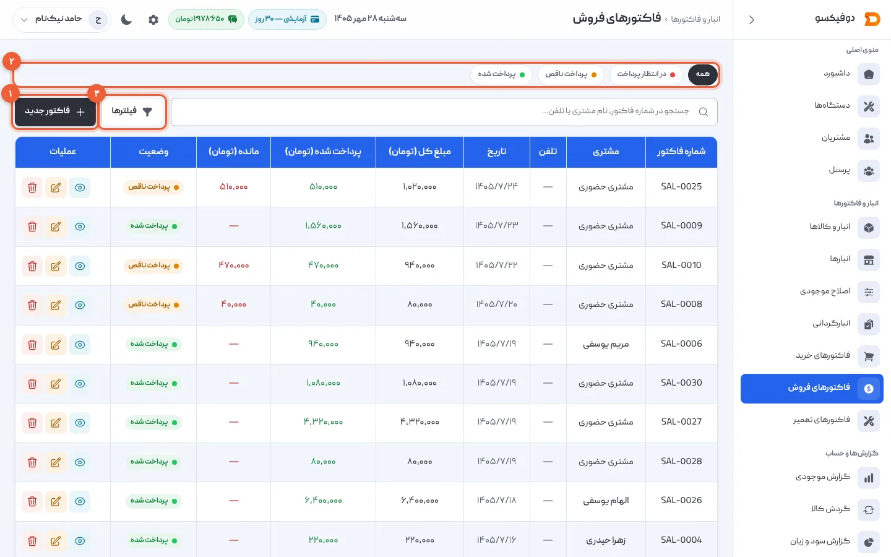
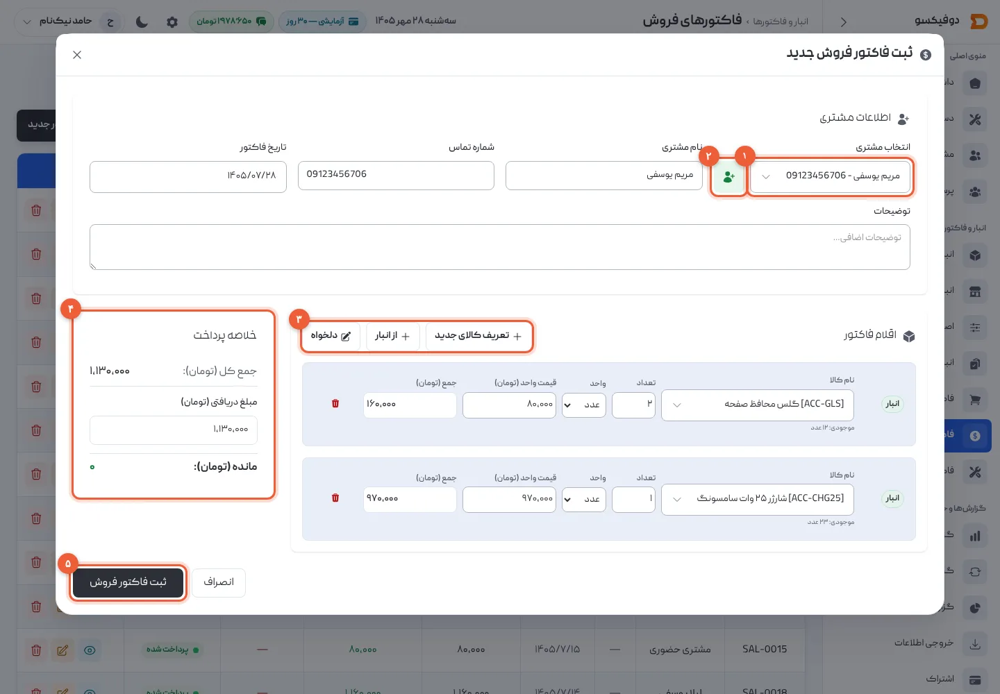
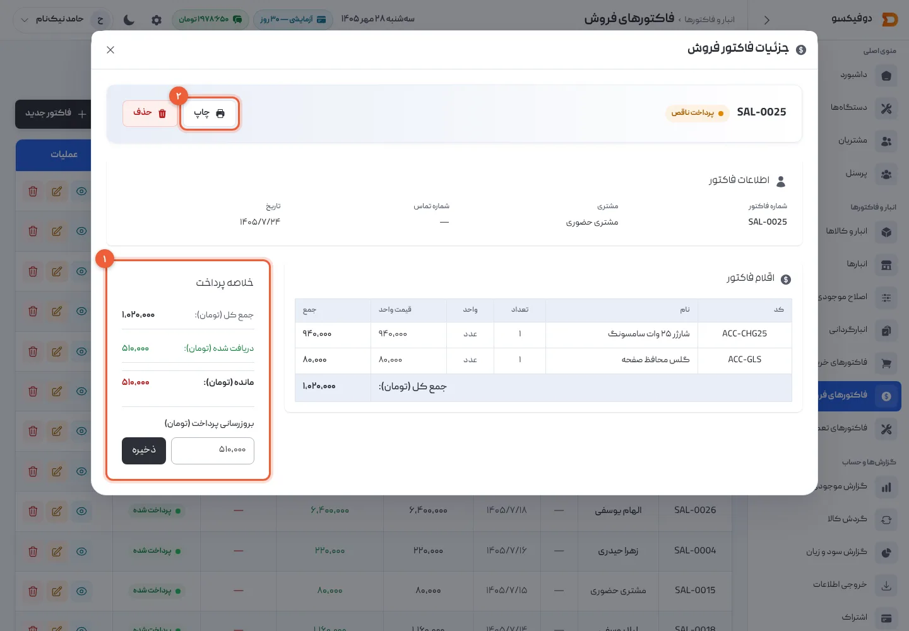
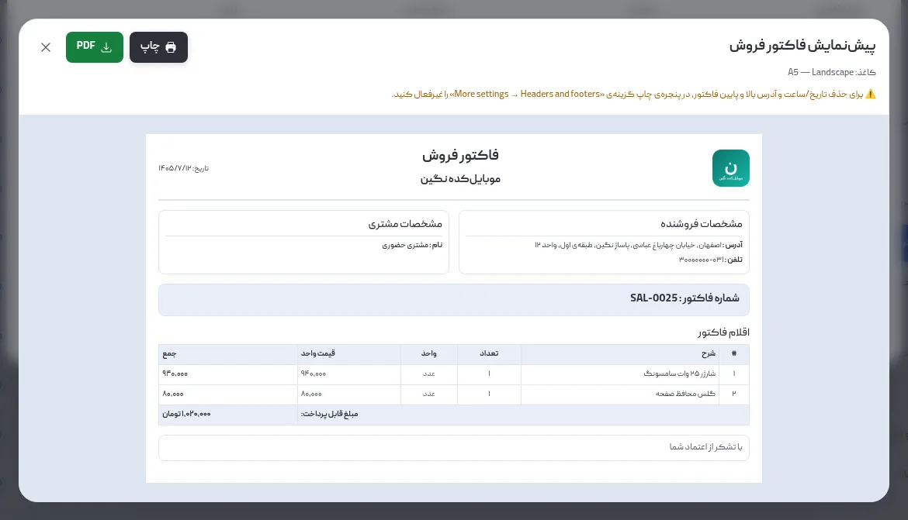
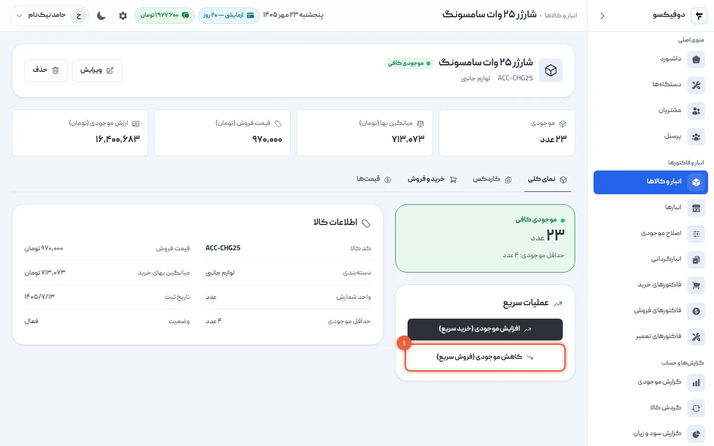
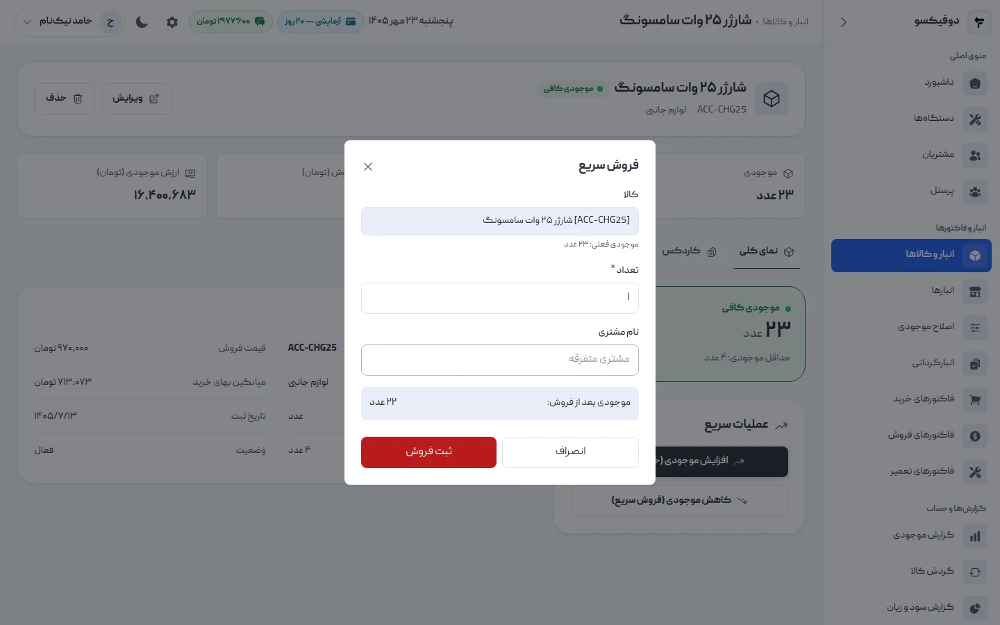

همه‌ی درآمد تعمیرگاه از تعمیر نیست. گلس، قاب، شارژر و کابلی که مشتری از پشت پیشخوان
می‌خرد هم فروش است، و اگر ثبت نشود، هم موجودی دروغ می‌گوید و هم سود ماه کمتر از واقع
دیده می‌شود. در دوفیکسو این فروش‌ها با **فاکتور فروش** ثبت می‌شوند: کالا از انبار کم
می‌شود، سودش با بهای همان لحظه حساب می‌شود، و برگه‌اش روی کاغذی که خودتان انتخاب
کرده‌اید چاپ می‌شود.

فاکتور فروش برای **فروش کالا** است. برای تعمیر یک گوشی — قطعه و اجرت و گارانتی —
[فاکتور تعمیر](/academy/tutorials/repair-invoice/) را به کار ببرید. فاکتورها را فقط
مدیرها می‌بینند.

## ۱. فهرست فاکتورهای فروش

از منوی کناری **«فاکتورهای فروش»** را باز کنید. هر فروش با شماره‌ی `SAL-…`، مشتری،
تاریخ، مبلغ کل، پرداخت‌شده و **مانده** این‌جاست.

- **«فاکتور جدید»** (۱): قدم بعد.
- **وضعیت پرداخت** (۲): «در انتظار پرداخت» و «پرداخت ناقص» یعنی فروش‌هایی که هنوز
  تمام پولشان را نگرفته‌اید.
- **«فیلترها»** (۳): بازه‌ی تاریخ و بازه‌ی مبلغ.

## ۲. فاکتور فروش تازه ثبت کنید

«فاکتور جدید» را بزنید:

1. **انتخاب مشتری** (۱): نام یا شماره‌ی مشتری را بنویسید و از فهرست انتخاب کنید؛ نام
   و شماره‌اش پر می‌شوند. مشتری تازه است؟ دکمه‌ی **+** کنارش (۲) او را با نام و شماره
   ثبت می‌کند. مشتری گذری که نمی‌خواهید ثبتش کنید؟ همه را خالی بگذارید؛ فاکتور به نام
   **«مشتری متفرقه»** ثبت می‌شود.
2. **اقلام فاکتور** (۳): **«از انبار»** را بزنید و کالا را پیدا کنید. موجودی کالا زیر
   نامش است، و **قیمت فروشی** که در [تعریف کالا](/academy/tutorials/inventory/) نوشتید
   خودش پر می‌شود؛ اگر امروز قیمت دیگری می‌دهید، عوضش کنید. برای هر کالای دیگر، دوباره
   «از انبار». چیزی که در انبار نیست — مثلاً نصب گلس — با **«دلخواه»** اضافه می‌شود و
   به موجودی دست نمی‌زند.
3. **خلاصه پرداخت** (۴): در **مبلغ دریافتی** بنویسید همین حالا چقدر گرفتید. اگر نقد و
   کامل گرفتید، همان جمع کل؛ اگر نسیه است، کمتر یا صفر. **مانده** همان زیر حساب می‌شود.
4. **«ثبت فاکتور فروش»** (۵) را بزنید.

اگر بیش از یک انبار دارید، کنار تاریخ یک **«خروج از انبار»** هم می‌بینید که می‌گوید
کالا از کدام انبار برود.

<Callout type="benefit">
با «ثبت فاکتور فروش» **موجودی همان لحظه کم می‌شود**، و بهای تمام‌شده‌ی هر کالا در
همان لحظه روی فاکتور می‌ماند. سودی که گزارش سود و زیان برای این فروش نشان می‌دهد، با همین بهاست — حتی اگر ماه بعد همان شارژر را گران‌تر بخرید.
</Callout>

## ۳. نسیه و پرداخت بعدی

روی **«مشاهده جزئیات»** فاکتور بزنید. کادر **«خلاصه پرداخت»** (۱) جمع کل، دریافت‌شده و
مانده را نشان می‌دهد.

وقتی مشتری بقیه‌ی پول را داد، در **«بروزرسانی پرداخت»** مبلغ را بنویسید و «ذخیره» را
بزنید. وضعیت خودش «پرداخت شده» یا «پرداخت ناقص» می‌شود.

<Callout type="warning">
در «بروزرسانی پرداخت»، **کل مبلغی را که تا امروز گرفته‌اید** بنویسید، نه فقط پولی که
همین حالا رسید. اگر از فاکتور ۱٬۰۲۰٬۰۰۰ تومانی قبلاً ۵۱۰٬۰۰۰ گرفته‌اید و بقیه را هم
آورد، ۱٬۰۲۰٬۰۰۰ بنویسید. فاکتور فروش، برخلاف فاکتور تعمیر، تاریخچه‌ی پرداخت ندارد؛ فقط
جمع دریافتی را نگه می‌دارد.
</Callout>

## ۴. چاپ: A4، A5 یا رسید حرارتی

در جزئیات فاکتور، **«چاپ»** (۲) را بزنید. پیش‌نمایش با همان قالبی باز می‌شود که در
[تنظیمات، تب «تنظیمات فاکتورها»](/academy/tutorials/settings/) انتخاب کرده‌اید: اندازه‌ی
کاغذ، بخش‌هایی که نمایش داده شوند، و متن بالا و پایین — همان قالبی که فاکتور تعمیر و
خرید هم با آن چاپ می‌شوند.

از همین پیش‌نمایش چاپ کنید، یا **PDF** بگیرید و برای مشتری بفرستید.

<Callout type="tip">
چاپگر حرارتی پشت پیشخوان دارید؟ در تنظیمات اندازه‌ی کاغذ را **Thermal** بگذارید تا
فاکتور فروش رسید باریک ۸۰ میلی‌متری شود. اگر بالا و پایین برگه تاریخ و آدرس صفحه چاپ
شد، در پنجره‌ی چاپ مرورگر «Headers and footers» را خاموش کنید؛ خود پیش‌نمایش هم همین
را یادآوری می‌کند.
</Callout>

## ۵. فروش سریع، بی‌فرم

مشتری فقط یک گلس می‌خواهد و صف پشت سرش است؟ لازم نیست فرم فاکتور را باز کنید. در
[صفحه‌ی همان کالا](/academy/tutorials/inventory/)، در کادر «عملیات سریع»، **«کاهش
موجودی (فروش سریع)»** (۱) را بزنید.

تعداد را بنویسید — و اگر خواستید نام مشتری — و «ثبت فروش» را بزنید. موجودی بعد از
فروش همان‌جا دیده می‌شود.

فروش سریع هم یک فاکتور فروش کامل با شماره‌ی `SAL-…` است: به **قیمت فروش** کالا (اگر
قیمت فروش ندارد، به میانگین بها)، **پرداخت‌شده**، و در فهرست فاکتورهای فروش پیدا می‌شود. اگر قیمت یا پرداخت فرق داشت،
از همان فهرست ویرایشش کنید.

## ۶. ویرایش و حذف

فاکتور فروش **همیشه قابل ویرایش است** — از دکمه‌ی «ویرایش فاکتور» در ردیفش — و موجودی
هم‌پایش اصلاح می‌شود: کالایی که از فاکتور برداشتید به انبار برمی‌گردد و کالای تازه کم
می‌شود. شماره‌ی فاکتور عوض نمی‌شود.

مدیرها فاکتور را با **«حذف»** کاملاً پاک می‌کنند و کالاهایش به انبار برمی‌گردند. شماره‌اش
در فهرست خالی می‌ماند؛ اگر فقط چیزی در آن غلط است، ویرایش را به حذف ترجیح دهید.

## اگر … شد چه کنم؟

**«موجودی کافی نیست»:** این کالا به اندازه‌ای که نوشتید در انبار نیست. اگر خریده‌اید،
[فاکتور خریدش](/academy/tutorials/purchase-invoice/) را ثبت کنید؛ اگر عدد انبار غلط
است، با «اصلاح موجودی» درستش کنید.

**«قیمت باید مثبت باشد»:** قیمت هیچ ردیفی صفر نمی‌شود. کالایی را که هدیه می‌دهید،
با «اصلاح موجودی» از انبار کم کنید، نه با فاکتور فروش صفر تومانی.

**«این کالا فقط عدد صحیح می‌پذیرد»:** واحد این کالا «عدد» است. تعداد را بدون اعشار
بنویسید.

**مانده بعد از پرداخت درست نشد:** در «بروزرسانی پرداخت» کل دریافتی را می‌نویسید، نه
قسط آخر (قدم ۳).

**فاکتور فروش را در صفحه‌ی مشتری نمی‌بینم:** فاکتور به نام «مشتری متفرقه» یا با نامی
تایپ‌شده ثبت شده، نه با انتخاب مشتری از فهرست. فقط فاکتوری که مشتری‌اش از فهرست انتخاب
شده، در [پرونده‌ی مشتری](/academy/tutorials/customers/) می‌آید.

<NextStep
  title="برگه‌ی فاکتورها را به شکل تعمیرگاه خودتان دربیاورید"
  to="tutorials/settings"
  label="آموزش تنظیمات"
>

اندازه‌ی کاغذ (A4، A5 یا رسید حرارتی)، لوگو، مهر و امضا و متن بالا و پایین فاکتور،
همه در تب «تنظیمات فاکتورها»‌اند.

</NextStep>
