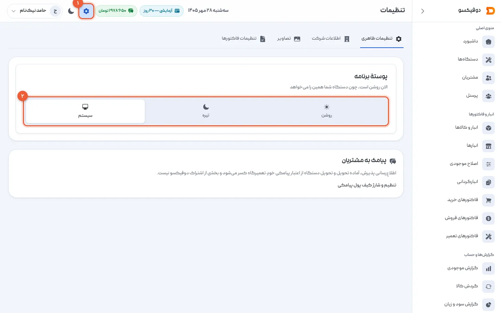
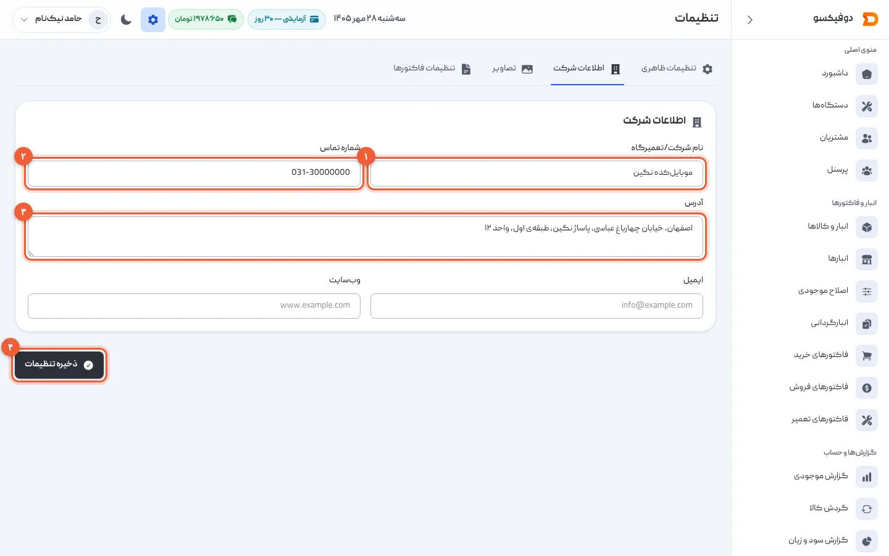
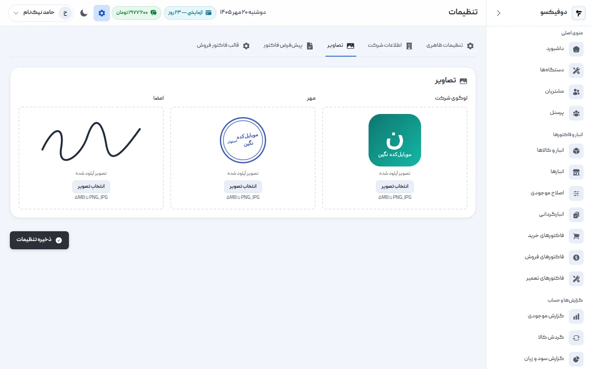
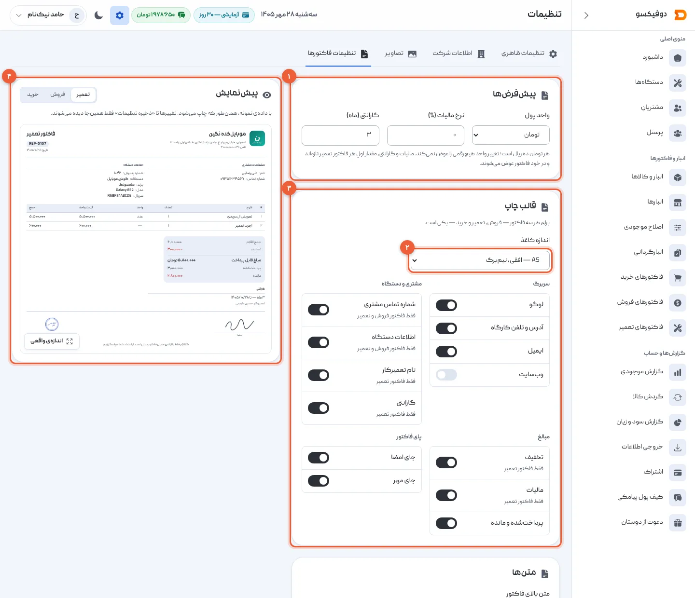
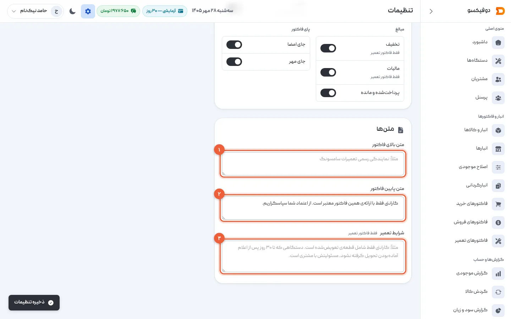
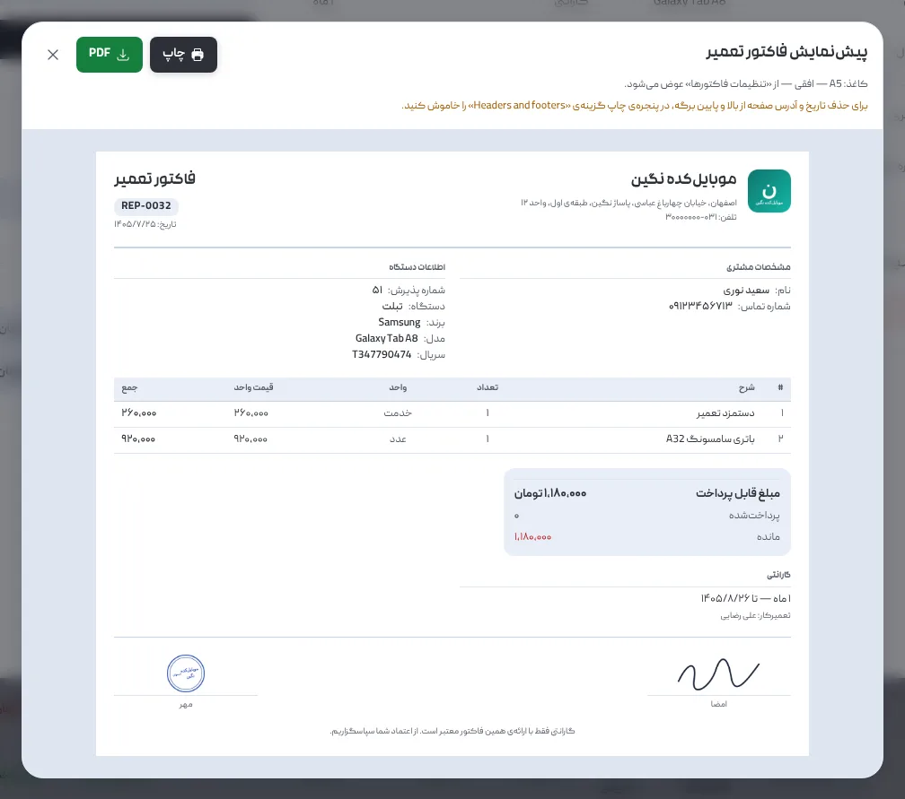

تنظیمات، جایی است که دوفیکسو را **مال تعمیرگاه خودتان** می‌کنید: نام و آدرسی که
روی فاکتور می‌آید، لوگو و مهر و امضا، گارانتی‌ای که معمولاً می‌دهید، و شکل
فاکتورهای چاپی. همه را یک بار تنظیم می‌کنید و بعد هر فاکتور خودش درست پر می‌شود.

در این آموزش همه‌ی تب‌های تنظیمات را به ترتیب می‌بینیم. سه تب از چهار تب را فقط
**سوپر ادمین** — سازنده‌ی حساب — می‌بیند. ادمین‌ها و تکنسین‌ها فقط تب «تنظیمات
ظاهری» را دارند.

## ۱. تنظیمات را باز کنید؛ پوسته را انتخاب کنید

روی آیکون چرخ‌دنده‌ی **«تنظیمات»** (۱) بالای صفحه بزنید. اولین تب، **«تنظیمات
ظاهری»**، پوسته‌ی برنامه است (۲): **روشن**، **تیره**، یا **سیستم** که از تنظیم
گوشی یا کامپیوترتان پیروی می‌کند.

پوسته روی **همان مرورگر** ذخیره می‌شود، نه برای کل تعمیرگاه: اگر شما روی گوشی خودتان
تیره را انتخاب کنید و تعمیرکار روی کامپیوتر مغازه روشن را، هر کدام همان را
می‌بینید.

پایین همین تب، کادر «پیامک به مشتریان» شما را به **کیف پول پیامکی** می‌برد؛ روشن
کردن پیامک و شارژش آن‌جاست، نه در تنظیمات.

## ۲. اطلاعات تعمیرگاه

تب **«اطلاعات شرکت»**:

- **نام شرکت/تعمیرگاه** (۱): همان نامی که در ثبت‌نام نوشتید، این‌جا عوض می‌شود.
- **شماره تماس** (۲): شماره‌ای که مشتری برای پیگیری می‌گیرد. اگر چند شماره دارید،
  با ویرگول جدا کنید.
- **آدرس** (۳)
- **ایمیل** و **وب‌سایت**: اختیاری.

«ذخیره تنظیمات» (۴) را بزنید.

<Callout type="benefit">
نام تعمیرگاه از همین‌جا به **پیامک‌های مشتری** و **سربرگ هر فاکتور** می‌رود، و
شماره و آدرس روی فاکتور چاپ می‌شوند. مشتری‌ای که ماه بعد با همان گوشی برگشت،
روی فاکتورش می‌بیند کجا را پیدا کند و به چه شماره‌ای زنگ بزند.
</Callout>

## ۳. لوگو، مهر و امضا

تب **«تصاویر»** سه جا برای تصویر دارد: **لوگوی شرکت**، **مهر** و **امضا**. روی
«انتخاب تصویر» زیر هر کدام بزنید و فایل را انتخاب کنید (PNG یا JPG، تا ۵ مگابایت).

هر تصویر **همان لحظه** ذخیره می‌شود؛ لازم نیست «ذخیره تنظیمات» را بزنید.

<Callout type="tip">
مهر و امضا را روی کاغذ سفید بزنید، با گوشی از روبه‌رو و در نور خوب عکس بگیرید و
دور عکس را ببرید. اگر فایل PNG با زمینه‌ی شفاف دارید، روی فاکتور تمیزتر می‌نشیند.
</Callout>

## ۴. تنظیمات فاکتورها: پیش‌فرض‌ها و قالب چاپ

تب **«تنظیمات فاکتورها»** هر چیزی را که به فاکتور مربوط است یک‌جا دارد. سمت چپ،
یک **پیش‌نمایش** (۴) هست که با هر تغییر، همان لحظه عوض می‌شود.

**پیش‌فرض‌ها** (۱):

- **واحد پول:** **تومان** یا **ریال**. همه‌ی مبلغ‌های تعمیرگاه — فاکتورها، انبار،
  گزارش‌ها — با همین واحد نمایش داده و وارد می‌شوند. عوض کردنش هیچ رقمی را عوض
  نمی‌کند؛ فقط نوشتنش فرق می‌کند. پیش‌فرض تومان است. (خروجی اکسل همیشه به ریال
  است، و قیمت اشتراک و شارژ پیامک همیشه به تومان.)
- **نرخ مالیات (٪):** نرخی که هر فاکتور تعمیر تازه با آن باز می‌شود. اگر مالیات
  نمی‌گیرید، ۰ بگذارید.
- **گارانتی (ماه):** گارانتی معمول شما روی تعمیر. پیش‌فرضش ۳ ماه است.

**قالب چاپ** برای هر سه فاکتور — فروش، تعمیر و خرید — **یکی** است:

- **اندازه کاغذ** (۲): **A4** (عمودی، کامل)، **A5** (افقی، نیم‌برگ) یا **رول
  حرارتی ۸۰ میلی‌متری** — رسید باریک برای چاپگرهای حرارتی پشت پیشخوان.
- **بخش‌هایی که چاپ شوند** (۳): لوگو، آدرس و تلفن کارگاه، ایمیل، وب‌سایت، شماره‌ی
  تماس مشتری، اطلاعات دستگاه، نام تعمیرکار، گارانتی، تخفیف، مالیات، **پرداخت‌شده و
  مانده**، و جای امضا و مهر. کنار کلیدهایی که فقط به یک نوع فاکتور مربوط‌اند نوشته
  شده کدام — مثلاً گارانتی فقط روی فاکتور تعمیر است.

در پیش‌نمایش، بین **تعمیر**، **فروش** و **خرید** جابه‌جا شوید تا ببینید هر کدام
چطور چاپ می‌شود، و با **«اندازه‌ی واقعی»** برگه را در اندازه‌ی خودش ببینید. پیش‌نمایش
با داده‌ی نمونه است؛ تغییرها تا «ذخیره تنظیمات» را نزنید روی فاکتورهای واقعی
نمی‌نشینند.

شماره‌ی فاکتورها را دوفیکسو خودش می‌گذارد — `REP-0001` برای تعمیر، `SAL-0001` برای
فروش و `PUR-0001` برای خرید — پشت‌سرهم و بدون جاافتادگی.

<Callout type="benefit">
با گارانتی پیش‌فرض، **تاریخ پایان گارانتی** روی هر فاکتور تعمیر خودش حساب و چاپ
می‌شود. وقتی مشتری با همان گوشی برگشت، فاکتور جواب می‌دهد که گارانتی هنوز باقی
است یا نه — نه حافظه‌ی شما، نه حرف مشتری.
</Callout>

<Callout type="tip">
اگر پشت پیشخوان چاپگر حرارتی دارید، رول حرارتی را انتخاب کنید و بخش‌های کم‌اهمیت
مثل ایمیل و وب‌سایت را خاموش کنید تا رسید کوتاه بماند.
</Callout>

## ۵. متن‌های فاکتور

پایین همان تب، سه متن:

- **متن بالای فاکتور** (۱): زیر سربرگ، روی هر سه فاکتور؛ مثلاً «نمایندگی رسمی
  تعمیرات …».
- **متن پایین فاکتور** (۲): آخر برگه، روی هر سه فاکتور؛ مثلاً شرط گارانتی یا تشکر.
- **شرایط تعمیر** (۳): **فقط روی فاکتور تعمیر**، زیر اقلام؛ مثلاً «گارانتی فقط شامل
  قطعه‌ی تعویض‌شده است» یا «دستگاهی که تا ۳۰ روز پس از اعلام آماده‌بودن تحویل گرفته
  نشود، مسئولیتش با مشتری است».

«ذخیره تنظیمات» را بزنید. مالیات و گارانتی **پیش‌فرض**اند: در هر فاکتور تعمیر
می‌شود عوضشان کرد، ولی لازم نیست هر بار بنویسیدشان.

## ۶. نتیجه را روی یک فاکتور ببینید

یک فاکتور تعمیر را باز کنید و **«چاپ»** را بزنید. پیش‌نمایش، همان چیزی است که
مشتری می‌گیرد: لوگو و نام و آدرس تعمیرگاه بالا، گارانتی با تاریخ پایانش، و مهر و
امضا و متن پایین فاکتور زیرش.

از همین پیش‌نمایش می‌شود چاپ کرد یا **PDF** گرفت و برای مشتری فرستاد.

## اگر … شد چه کنم؟

**تب‌های «اطلاعات شرکت»، «تصاویر» و … را نمی‌بینم:** این تب‌ها فقط برای سوپر
ادمین — سازنده‌ی حساب — است. بالای صفحه نوشته «دسترسی محدود — فقط تنظیمات ظاهری».
با حساب او وارد شوید.

**تصویر بارگذاری نمی‌شود:** فایل باید تصویر باشد (PNG یا JPG) و از ۵ مگابایت
کوچک‌تر. عکس گوشی را پیش از بارگذاری کوچک کنید.

**بخشی را خاموش کردم ولی هنوز روی فاکتور هست:** «ذخیره تنظیمات» را زده‌اید؟
پیش‌نمایش تب، تغییر را پیش از ذخیره هم نشان می‌دهد، ولی فاکتورهای واقعی فقط بعد از
ذخیره با قالب تازه چاپ می‌شوند. قالب برای هر سه نوع فاکتور یکی است؛ اگر بخشی را
فقط روی فاکتور فروش نمی‌خواهید و روی تعمیر می‌خواهید، فعلاً نمی‌شود.

**گارانتی یا مالیات فاکتور با تنظیمات فرق دارد:** تنظیمات فقط مقدار **اولیه‌ی**
فاکتورهای تازه است. فاکتورهایی که قبلاً صادر شده‌اند، با همان مقدار خودشان
می‌مانند.

<NextStep
  title="تعمیرکارها را اضافه کنید"
  to="tutorials/personnel"
  label="آموزش تعریف تعمیرکار"
>

برای هر تعمیرکار حساب جدا بسازید: هر کس با شماره‌ی خودش وارد می‌شود، فقط
دستگاه‌ها و مشتری‌ها را می‌بیند، و کار هر نفر جدا شمرده می‌شود.

</NextStep>
